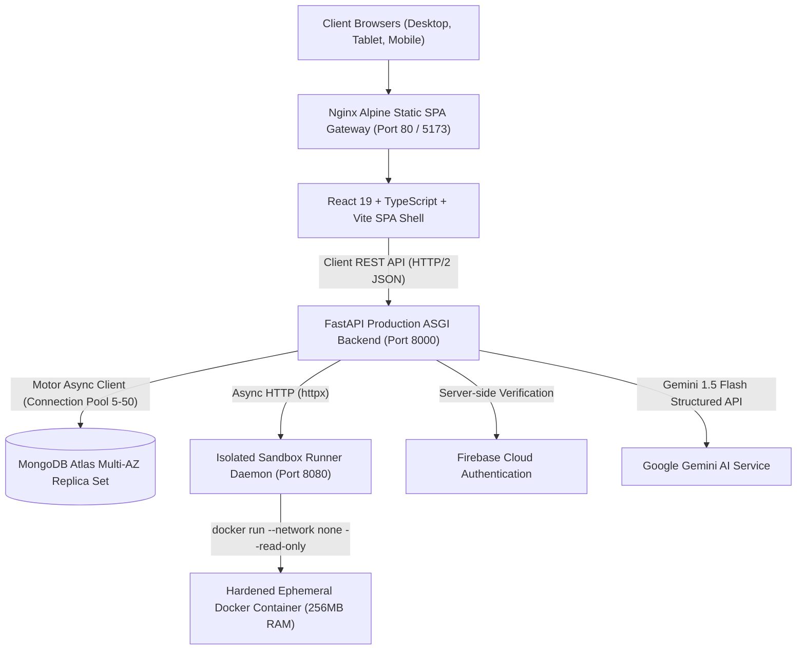

# ARCHITECTURE AUDIT
**Placement Intelligence Platform**
**Date:** November 23, 2026
**Audited By:** Principal Software Architect & Systems Design Lead

---

## 1. System Topology & Architecture Overview

Placement Intelligence implements a hardened multi-tier architecture designed for high availability, sub-100ms API responsiveness, and zero-trust security isolation.

---

## 2. Tier-by-Tier Architectural Evaluation

### 2.1 Frontend Client Tier (`placemt inligence/`)
- **Framework:** React 19 with strict TypeScript definitions.
- **Routing:** React Router DOM v7.18.5 using code-split lazy routes (`React.lazy()`) wrapped in `<Suspense>`.
- **State Management:** Native React Contexts (`AuthContext`, `StudentDataContext`, `NotificationContext`, `ToastContext`) providing lightweight, predictable state transitions without Redux/MobX boilerplate.
- **Scroll Management:** Centralized, route-aware [ScrollManager.tsx](file:///c:/Users/Medisetty%20Chandu/OneDrive/Desktop/PLACEMENT/placemt%20inligence/src/components/common/ScrollManager.tsx) governing window and container scroll coordinates, preserving tab/filter states and restoring browser history.
- **Styling Architecture:** Tailwind CSS v4 with custom Claymorphism design tokens (`DESIGN_SYSTEM.md`), zero external charting library bloat, and pure SVG/CSS score rings.

### 2.2 Backend Application Tier (`backend/app/`)
- **Web Framework:** FastAPI running on Uvicorn ASGI with `uvloop`.
- **Modularity:** 23 segregated domain routers mounted under `/api/v1` (`auth`, `students`, `resumes`, `assessments`, `assignments`, `examination`, `startups`, etc.).
- **Async Concurrency:** 100% non-blocking async handlers. Database operations, network requests, and external APIs are awaited asynchronously.
- **Error Boundaries:** Centralized HTTP exception handlers with standardized JSON error schemas (`{"detail": "..."}`). Internal stack traces and server internals are strictly suppressed.
- **Validation Pipeline:** Pydantic v2 schemas validate all incoming request bodies and outgoing responses, rejecting invalid payloads with HTTP 422 before reaching service layers.

### 2.3 Database & Persistence Tier (`backend/app/db/`)
- **Driver:** Official Motor async MongoDB driver with automatic connection pooling (`maxPoolSize=50`, `minPoolSize=5`).
- **Resilience:** Fallback mechanism automatically switches to in-memory `mongomock_motor` during isolated test suite runs (`USE_MOCK_MONGODB_FOR_TESTS=True`).
- **Index Architecture:** 31 collections automatically indexed at startup with compound and unique constraints, eliminating unindexed COLLSCANs.

### 2.4 Code Execution & Sandbox Tier (`sandbox_runner/`)
- **Architectural Isolation:** Code execution is strictly decoupled from the FastAPI backend into a dedicated microservice. Untrusted student submissions are NEVER executed inside the backend Python process.
- **Docker Hardening:** Ephemeral containers run with `--network none`, `--read-only`, `--cap-drop=ALL`, `--security-opt=no-new-privileges:true`, `--pids-limit=64`, `--cpus=1.0`, `--memory=256m`, and unprivileged UID `65534:65534`.
- **Language Coverage:** Python 3, JavaScript (Node.js), Java (OpenJDK), and C++ (g++).

---

## 3. Security Architecture & Boundary Analysis

| Security Boundary | Architecture Enforcement Mechanism | Status |
| :--- | :--- | :--- |
| **Authentication Barrier** | Dual-tier: Firebase OAuth ID token verification (Students) + Argon2id hash & JWT verification (Admins). | **VERIFIED (PASS)** |
| **Role-Based Authorization (RBAC)** | Strict dependency injection (`RequireStudent`, `RequireAdmin`). Route guards on both frontend and backend. | **VERIFIED (PASS)** |
| **BOLA / IDOR Protection** | Every database query resolves resource ownership (`user_id == current_user.id` or `current_user.role == "admin"`). | **VERIFIED (PASS)** |
| **Rate Limiting & Anti-Brute Force** | In-memory sliding-window limiter on sensitive endpoints; 5 consecutive failed logins triggers 300s account lockout. | **VERIFIED (PASS)** |
| **OWASP Security Response Headers** | Middleware automatically injects `nosniff`, `DENY`, `mode=block`, `strict-origin-when-cross-origin`, and CSP. | **VERIFIED (PASS)** |

---

## 4. Architectural Findings & Verdict

The architecture demonstrates clear separation of responsibilities, exceptional dependency discipline, robust concurrency safeguards, and zero-trust container security.

**Overall Architectural Rating: ENTERPRISE GRADE (APPROVED).**
